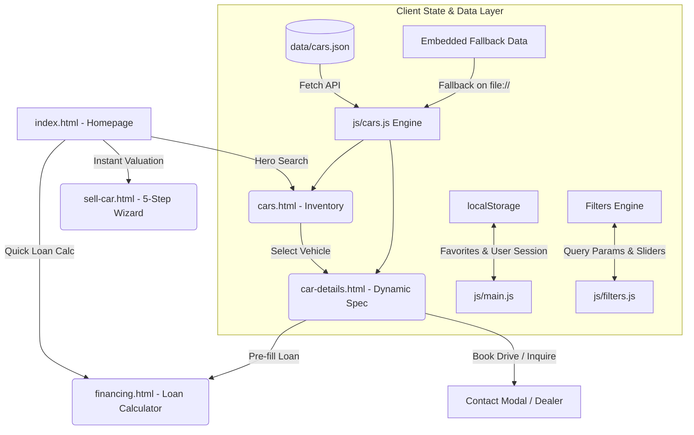

# 🏎️ Antixorcar.com — Premium Automotive Marketplace

[](index.html)
[](css/style.css)
[](index.html)
[](LICENSE)

> **"Drive Your Dreams"** — Antixorcar.com is a luxury, modern automotive marketplace and e-commerce web platform designed for buying, selling, comparing verified vehicles, and calculating real-time auto financing. Built exclusively with **Bootstrap 5.3.3**, ultra-clean HTML5, a custom automotive CSS design engine with glassmorphism styles, and pure vanilla JavaScript (ES6+). Zero Tailwind CSS dependency.

---

## 📑 Table of Contents

- [✨ Key Features](#-key-features)
- [🖥️ Page Overview](#️-page-overview)
- [🏗️ System Architecture & Workflow](#️-system-architecture--workflow)
- [📂 Project Structure](#-project-structure)
- [🚀 Quick Start & Launch](#-quick-start--launch)
- [🚗 Vehicle Data Schema](#-vehicle-data-schema)
- [💡 Technical Highlights](#-technical-highlights)
- [🎨 Design System & Brand Palette](#-design-system--brand-palette)
- [🛠️ Customization Guide](#️-customization-guide)
- [📄 License & Credits](#-license--credits)

---

## ✨ Key Features

### 🔍 Advanced Multi-Filter Search Engine
- **Cascading Selectors:** Dynamic make-to-model dropdowns (e.g., selecting *Porsche* instantly populates *911 Carrera*, *Taycan*, *Panamera*).
- **Multi-Attribute Filtering:** Filter vehicles simultaneously by **Make**, **Model**, **Body Type** (SUV, Sedan, Sports, Electric, Truck), **Condition** (New, Certified Pre-Owned, Used), **Price Range**, **Mileage**, **Transmission**, and **Fuel Type**.
- **Real-Time Inventory Counter:** Live updates reflecting exact counts of vehicles matching active criteria.
- **Cross-Page Query Synchronization:** Search from the homepage search panel carries directly to the inventory page with active filters applied.

### 🚘 Dynamic Vehicle Catalog & Detail Pages
- **Rich Vehicle Cards:** High-definition photography, price badges, certified inspection indicators, performance highlights (HP, 0-60 mph, transmission, drivetrain), and one-click favorites.
- **Dynamic Detail Views:** Seamlessly loads full vehicle specifications via URL query parameters (`car-details.html?id=mercedes-gle-350`).
- **Interactive Photo Gallery:** High-res thumbnail gallery switcher with zoom and inspection previews.
- **Inspection & History Reports:** 160-point mechanical check status, accident-free verification, service history, and official VIN disclosure.
- **Direct Dealer Concierge:** Verified dealer contact card, booking forms for private test drives, and direct loan pre-fill links.

### 💰 Real-Time Auto Loan & Financing Calculator
- **Bi-Directional Synchronized Inputs:** Real-time synchronization between visual range sliders and manual numeric inputs for vehicle price, down payment, and interest rate (APR).
- **Complete Amortization Breakdown:** Instant calculation of:
  - Monthly payment installments (`$/month`)
  - Total principal amount
  - Total interest charges over loan duration
  - Total loan repayment amount
- **Visual Ratio Distribution:** Dynamic progress bar showing principal vs. interest breakdown.
- **Pre-fill Integration:** Seamlessly carries vehicle prices from inventory or detail pages via URL parameters (e.g. `financing.html?price=68000`).

### 📝 5-Step Interactive Car Seller Wizard
- **Step 1:** Basic vehicle information (Make, Model, Year, Body Type, Mileage).
- **Step 2:** Technical specifications & condition rating (Engine, Transmission, Fuel, Certified Condition).
- **Step 3:** Interactive photo upload zone with drag-and-drop preview simulation.
- **Step 4:** Valuation & pricing strategy (Asking price, negotiation flexibility).
- **Step 5:** Seller contact information and instant listing confirmation.

### 📈 Instant 2-Minute Market Valuation Tool
- Instant estimation modal accessible from the homepage.
- Computes estimated dealer and private market valuation ranges based on vehicle make and model.
- One-click CTA that transports sellers directly into the listing wizard with pre-populated data.

### ❤️ Wishlist & Saved Vehicles System
- **Client-Side Persistence:** Instant saving and removal of vehicles powered by `localStorage`.
- **Live Counter Badges:** Header navigation reflects saved car counts in real-time.
- **Filter by Favorites:** One-click toggle (`cars.html?favorites=true`) to review all shortlisted vehicles.

### 👤 Simulated User Authentication
- Complete sign-in (`login.html`) and registration (`register.html`) flows.
- Session persistence via `localStorage` (`antixor_user`).
- Dynamic navbar avatar, personalized greeting dropdown, and one-click sign-out functionality.

---

## 🖥️ Page Overview

| File | Page Title | Key Capabilities |
| :--- | :--- | :--- |
| [`index.html`](index.html) | **Homepage** | Hero search panel, featured vehicle carousel, category grid, 2-minute valuation widget, testimonials, and trust stats. |
| [`cars.html`](cars.html) | **Vehicle Inventory** | Comprehensive multi-filter sidebar, grid/list view switcher, sorting (Price, Year, Mileage), pagination, and active filter tags. |
| [`car-details.html`](car-details.html) | **Vehicle Details** | Dynamic spec renderer, multi-image gallery, 160-point check report, seller contact card, and test-drive booking form. |
| [`sell-car.html`](sell-car.html) | **Sell Your Car** | 5-step guided listing wizard, instant valuation calculator, photo uploader, and benefits showcase. |
| [`financing.html`](financing.html) | **Auto Loan Calculator** | Real-time payment calculator, interest vs. principal visual graph, term options (12-84 months), and pre-approval request form. |
| [`about.html`](about.html) | **About Us** | Brand story, 160-point inspection breakdown, company values, leadership team, and partner network. |
| [`contact.html`](contact.html) | **Contact & Concierge** | Inquiry form, interactive FAQ accordion, dealership support, emergency hotline, and office locations. |
| [`login.html`](login.html) | **Sign In** | User sign-in with remember-me option, mock credentials, and quick authentication redirect. |
| [`register.html`](register.html) | **Sign Up** | New user onboarding form with real-time field validation and terms agreement. |

---

## 🏗️ System Architecture & Workflow



---

## 📂 Project Structure

```text
antixorcar/
├── assets/
│   ├── icons/
│   │   ├── brands/              # Official SVG logos (Audi, BMW, Porsche, Mercedes, etc.)
│   │   └── logo.svg             # Antixorcar brand monogram icon
│   └── images/                  # High-resolution vehicle and banner photography
├── css/
│   └── style.css                # Bootstrap 5 integration, brand tokens, glassmorphism, & animations
├── data/
│   └── cars.json                # JSON catalog with 12+ luxury and everyday vehicles
├── js/
│   ├── carousel.js              # Touch-friendly testimonial & showcase carousel
│   ├── cars.js                  # Vehicle catalog loader, renderer & embedded fallback
│   ├── filters.js               # Multi-filter search engine & cascading dropdowns
│   ├── financing.js             # Amortization loan & interest calculator
│   └── main.js                  # Global navbar, mobile menu, toast notifications, auth & wishlist
├── about.html                   # About company, mission, inspection standards
├── car-details.html             # Dynamic vehicle specifications & booking page
├── cars.html                    # Inventory catalog with advanced multi-filtering
├── contact.html                 # Concierge support, inquiries, and interactive FAQs
├── financing.html               # Real-time auto loan & payment calculator
├── index.html                   # Main landing page
├── login.html                   # Member sign-in page
├── register.html                # Member registration page
├── sell-car.html                # 5-step interactive vehicle listing wizard
└── README.md                    # Project documentation
```

---

## 🚀 Quick Start & Launch

Because this project is built with clean, standards-compliant web technologies, **no build step, compilers, or package installations (`npm install`) are required**.

### Option 1: Direct File Open (Zero Setup)
Simply navigate to the project directory and open [`index.html`](index.html) in any modern web browser:
- **Windows:** Double-click [`index.html`](index.html) or right-click $\rightarrow$ *Open with* $\rightarrow$ *Google Chrome* / *Microsoft Edge* / *Firefox*.
- *Note:* The catalog features an **embedded data fallback** inside [`js/cars.js`](js/cars.js) to guarantee 100% functionality even when running under the `file:///` protocol (bypassing browser CORS restrictions).

### Option 2: Local HTTP Server (Recommended)
Running through an HTTP server unlocks standard `fetch()` API calls against [`data/cars.json`](data/cars.json):

```bash
# Using Python 3
python -m http.server 3000

# Using Node.js npx serve
npx serve .

# Using VS Code
# Right-click 'index.html' -> Select "Open with Live Server"
```

Then visit your local server in your browser:
```text
http://localhost:3000
```

---

## 🚗 Vehicle Data Schema

Vehicles in [`data/cars.json`](data/cars.json) and [`js/cars.js`](js/cars.js) adhere to the following schema:

```json
{
  "id": "mercedes-gle-350",
  "make": "Mercedes-Benz",
  "model": "GLE 350 4MATIC",
  "year": 2023,
  "price": 68000,
  "formattedPrice": "$68,000",
  "mileage": 12500,
  "formattedMileage": "12,500 km",
  "condition": "Certified Pre-Owned",
  "bodyType": "SUV",
  "fuelType": "Petrol",
  "transmission": "Automatic",
  "engine": "2.0L Turbocharged Inline-4 (255 HP)",
  "drivetrain": "All-Wheel Drive (4MATIC)",
  "horsepower": 255,
  "acceleration": "6.9 sec (0-60 mph)",
  "exteriorColor": "Obsidian Black Metallic",
  "interiorColor": "Macchiato Beige / Nappa Leather",
  "location": "Beverly Hills, CA",
  "featured": true,
  "badge": "Featured",
  "rating": 4.9,
  "image": "assets/images/mercedes-gle.jpg",
  "gallery": [
    "assets/images/mercedes-gle.jpg",
    "assets/images/interior-1.jpg",
    "assets/images/interior-2.jpg",
    "assets/images/luxury-headlight.jpg"
  ],
  "description": "Exquisite 2023 Mercedes-Benz GLE 350 4MATIC...",
  "features": [
    "AMG Styling Exterior Package",
    "Panoramic Sliding Sunroof",
    "Burmester 13-Speaker Surround Sound"
  ],
  "seller": {
    "name": "Prestige Motorcars Group",
    "type": "Premier Verified Dealer",
    "phone": "+1 (800) 555-0199",
    "email": "concierge@prestigemotorcars.com",
    "rating": 4.95,
    "verified": true
  },
  "history": {
    "previousOwners": 1,
    "accidentFree": true,
    "serviceHistory": "100% Authorized Mercedes-Benz Center",
    "warranty": "24 Months Factory Certified Warranty",
    "vin": "4JGDF6EE4PA829104"
  }
}
```

---

## 💡 Technical Highlights

### 1. Pure Bootstrap 5.3.3 Foundation (Zero Tailwind Dependency)
The platform is powered completely by **Bootstrap 5.3.3** (`bootstrap.min.css` & `bootstrap.bundle.min.js`), integrated seamlessly with custom CSS variables and utility bridges in [`css/style.css`](css/style.css). This eliminates any runtime script overhead while retaining total styling flexibility.

### 2. Dual-Layer Data Loading
When loaded over an HTTP/HTTPS protocol, [`js/cars.js`](js/cars.js) asynchronously fetches data from [`data/cars.json`](data/cars.json). If loaded locally via `file:///` where browser CORS policies restrict local `fetch()`, the system gracefully and instantly switches to an embedded internal data object, guaranteeing 100% uptime with zero broken states.

### 3. Glassmorphism Sticky Navbar
The header employs an adaptive blur effect (`backdrop-blur-xl` and CSS `-webkit-backdrop-filter`) with an Intersection/Scroll listener that transitions smoothly between a lightweight translucent floating bar and a dense, elevated navy bar upon scrolling (`.navbar-scrolled`).

### 4. Reactive Toast Notifications
A lightweight custom toast notification system in [`js/main.js`](js/main.js) provides instant feedback for user actions (adding to favorites, signing in, form submissions) with smooth slide-in and fade-out CSS transitions.

### 5. Intersection Observer Stats Counters
Numerical milestones (e.g. 10,000+ happy buyers, 160-point inspection, $45M+ vehicle inventory) dynamically count up using ease-out cubic interpolation as soon as they scroll into view.

---

## 🎨 Design System & Brand Palette

The platform uses a carefully curated automotive color palette designed to evoke luxury, high performance, and trust:

| Token | Hex Value | Role / Usage |
| :--- | :--- | :--- |
| **Brand Orange** | `#F4511E` | Primary accent, CTA buttons, active state highlights, badges |
| **Brand Orange Hover** | `#D83C0B` | Hover state for buttons and interactive links |
| **Dark Navy** | `#071A2B` | Primary dark surface, navbar glass, headers, footers |
| **Deep Navy** | `#0B2638` | Secondary dark background, card container backgrounds |
| **Surface Navy** | `#112E44` | Elevated modal surfaces, inputs, card accents |
| **Light Background** | `#F5F7F9` | Page background for inventory and light content blocks |
| **Text Dark** | `#17212B` | Primary body typography for high legibility |
| **Text Muted** | `#667085` | Subtitles, captions, metadata labels |

### Typography
- **Primary Font:** [Plus Jakarta Sans](https://fonts.google.com/specimen/Plus+Jakarta+Sans) (Modern geometric sans-serif)
- **Secondary Font:** [Inter](https://fonts.google.com/specimen/Inter) (Engineered for clean numerical specifications)

---

## 🛠️ Customization Guide

### Adding New Vehicles
1. Open [`data/cars.json`](data/cars.json) (and the `DEFAULT_CARS_DATA` array in [`js/cars.js`](js/cars.js)).
2. Append a new vehicle object adhering to the schema described above.
3. Save your image assets into `assets/images/` and reference them in your new entry.
4. The car will automatically appear in searches, inventory grids, and detail pages.

### Changing Interest Rates or Loan Terms
1. Open [`js/financing.js`](js/financing.js).
2. Adjust default calculations, minimum/maximum sliders, and loan terms:
   ```javascript
   // Modify default interest rate or term selections
   const defaultRate = 4.9; // 4.9% APR
   ```

### Customizing Brand Colors in Bootstrap 5
1. Open [`css/style.css`](css/style.css).
2. Update the `:root` variables to your desired brand palette:
   ```css
   :root {
     --bs-primary: #F4511E;
     --primary-orange: #F4511E;
     --primary-orange-hover: #D83C0B;
     --dark-navy: #071A2B;
     --deep-navy: #0B2638;
   }
   ```
3. All buttons, badges, navigation borders, and brand accents will instantly reflect the new palette across every page.

---

## 🌐 Browser Compatibility

| Browser | Supported Versions |
| :--- | :--- |
| **Google Chrome** | Version 90+ |
| **Mozilla Firefox** | Version 88+ |
| **Microsoft Edge** | Version 90+ |
| **Apple Safari** | Version 14+ |
| **Mobile Browsers** | iOS Safari 14+, Chrome/Firefox for Android |

---

## 📄 License & Credits

- **Framework:** [Bootstrap 5.3.3](https://getbootstrap.com/) (CDN-delivered CSS & JavaScript Bundle)
- **License:** Distributed under the MIT License. Feel free to use and modify for commercial and personal projects.
- **Icons:** [Font Awesome 6.5.1](https://fontawesome.com/) & custom SVG brand marks.
- **Typography:** [Google Fonts](https://fonts.google.com/) (*Plus Jakarta Sans*, *Inter*).

---

<p align="center">
  <b>Antixorcar.com</b> • Drive Your Dreams • Built with ❤️ for Automotive Enthusiasts
</p>
